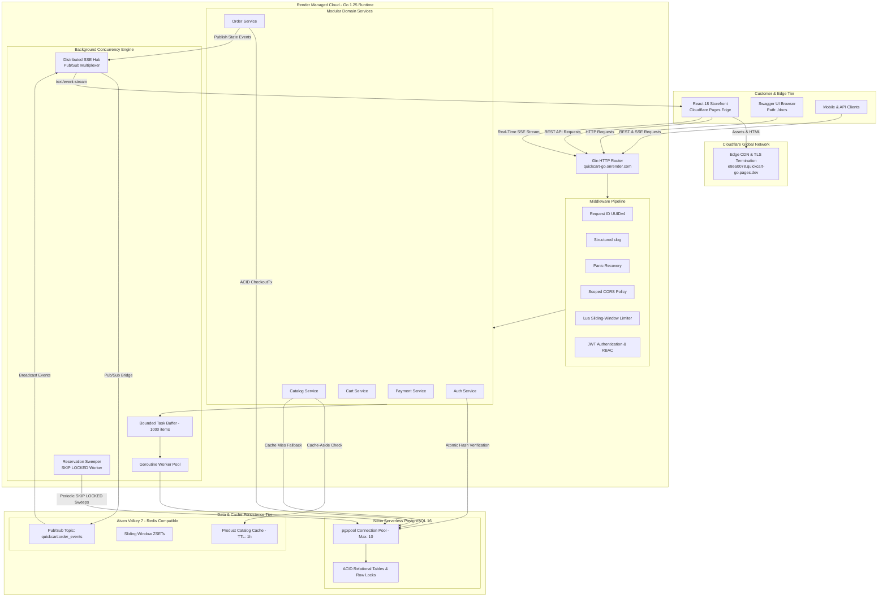
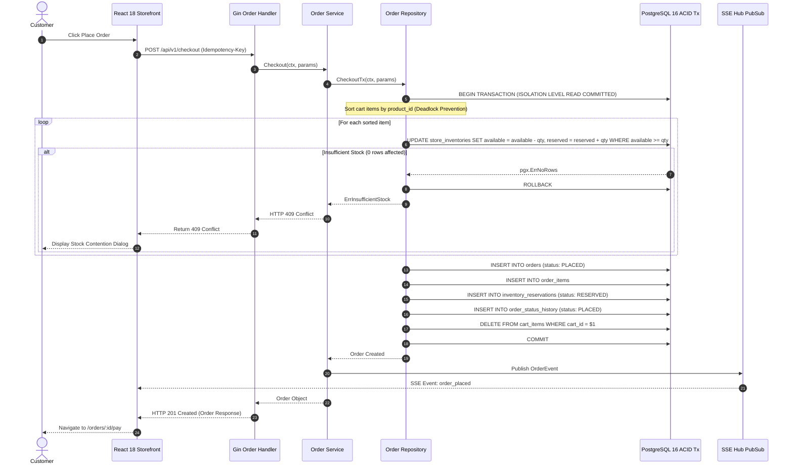
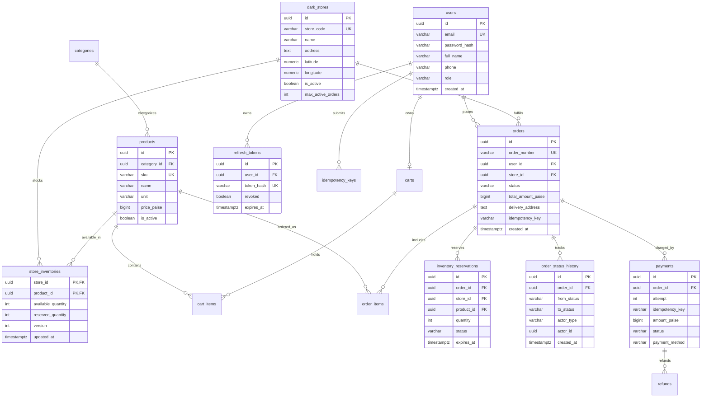

# QuickCart — Concurrent Quick-Commerce Engine

<div align="center">

[](https://e8ea0078.quickcart-go.pages.dev)
[](https://quickcart-go.onrender.com)
[](https://quickcart-go.onrender.com/docs)
[](https://github.com/Dhanya562004/quickcart-go/actions)

<br/>

[](https://react.dev)
[](https://www.typescriptlang.org)
[](https://tailwindcss.com)
[](https://vitejs.dev)
[](https://golang.org)
[-4169E1?style=flat&logo=postgresql&logoColor=white)](https://neon.tech)
[](https://aiven.io)
[](LICENSE)

<br/>

**A production-grade, full-stack quick-commerce platform engineered for micro-fulfillment speeds (< 10-minute delivery SLAs), mathematical zero-overselling inventory concurrency, and real-time order tracking.**

</div>

---

> ### 🚀 Quick Links & Live Demonstrations
>
> | Resource | Live URL | Description |
> | :--- | :--- | :--- |
> | 🛒 **Live Web Storefront** | [**https://e8ea0078.quickcart-go.pages.dev**](https://e8ea0078.quickcart-go.pages.dev) | Modern React 18 shopping interface deployed on Cloudflare Pages Edge Network |
> | ⚡ **Production Go API** | [**https://quickcart-go.onrender.com**](https://quickcart-go.onrender.com) | Go 1.25 REST + SSE backend hosted on Render (Redirects root `/` to `/docs`) |
> | 📖 **Interactive Swagger UI** | [**https://quickcart-go.onrender.com/docs**](https://quickcart-go.onrender.com/docs) | Complete interactive API explorer with OpenAPI 3.0 specification |
> | 📄 **OpenAPI Specification** | [**https://quickcart-go.onrender.com/api/openapi.yaml**](https://quickcart-go.onrender.com/api/openapi.yaml) | Validated OpenAPI 3.0.3 contract in raw YAML format |
> | 🩺 **Service Health Check** | [**https://quickcart-go.onrender.com/healthz**](https://quickcart-go.onrender.com/healthz) | Process liveness probe returning `200 OK` (`{"status":"alive"}`) |
> | 🔬 **Dependency Readiness** | [**https://quickcart-go.onrender.com/readyz**](https://quickcart-go.onrender.com/readyz) | Connectivity health check validating Neon PostgreSQL and Aiven Valkey |

---

## Table of Contents

- [Live Production Deployment](#live-production-deployment)
- [System Architecture](#system-architecture)
- [React Shopping Frontend](#react-shopping-frontend)
- [Engineering Highlights](#engineering-highlights)
- [Concurrent Checkout & Locking Engine](#concurrent-checkout--locking-engine)
- [Database Schema & ER Design](#database-design)
- [API Reference](#api-reference)
- [Reliability & Security Controls](#reliability--security-controls)
- [Testing & Quality Assurance](#testing--quality-assurance)
- [Local Development Setup](#local-development-setup)
- [Engineering Trade-offs](#engineering-trade-offs)
- [Roadmap & License](#roadmap--license)

---

## Live Production Deployment

QuickCart is deployed end-to-end on global managed cloud infrastructure:

| Component | Target Platform | Endpoint / URI | Status |
| :--- | :--- | :--- | :--- |
| **Storefront Web App** | Cloudflare Pages (Edge CDN) | [https://e8ea0078.quickcart-go.pages.dev](https://e8ea0078.quickcart-go.pages.dev) | 🟢 **Active & Live** |
| **Backend API Engine** | Render Web Service (Go Runtime) | [https://quickcart-go.onrender.com](https://quickcart-go.onrender.com/) | 🟢 **Active** (Redirects `/` to `/docs`) |
| **Interactive API Docs**| Swagger UI (OpenAPI 3.0) | [https://quickcart-go.onrender.com/docs](https://quickcart-go.onrender.com/docs) | 🟢 **Online** |
| **OpenAPI Specification**| Embedded YAML | [https://quickcart-go.onrender.com/api/openapi.yaml](https://quickcart-go.onrender.com/api/openapi.yaml) | 🟢 **Online** |
| **Process Liveness** | HTTP Probe | [https://quickcart-go.onrender.com/healthz](https://quickcart-go.onrender.com/healthz) | 🟢 `200 OK` (`{"status":"alive"}`) |
| **Dependency Readiness**| Database & Cache Probe | [https://quickcart-go.onrender.com/readyz](https://quickcart-go.onrender.com/readyz) | 🟢 `200 OK` (Pings DB & Valkey) |
| **Relational Database** | Neon PostgreSQL 16 (Serverless) | AWS `us-east-2` (Connection Pooled via TLS) | 🟢 Connected (`sslmode=require`) |
| **Cache & Pub/Sub** | Aiven Valkey 7 (Redis-Compatible) | TLS Protocol (`rediss://`) | 🟢 Connected |

> [!NOTE]
> **Free-Tier Cold Starts**: QuickCart's backend is hosted on Render's Free tier, which idles containers after 15 minutes of inactivity. When cold, the initial HTTP request may experience a ~30–50 second spin-up latency. Subsequent requests execute with sub-millisecond Go runtime dispatch.
> 
> **Clean Production Database**: The production Neon PostgreSQL database starts with zero seeded items. The frontend includes an **Interactive Demo Mode Banner** with a 1-click isolated client-side preview mode, alongside full admin cURL snippets to populate live dark stores, categories, and inventory.

---

## System Architecture

QuickCart is structured as an idiomatic **Go modular monolith** paired with a modern **React 18 SPA** hosted across distributed edge infrastructure.



---

## React Shopping Frontend

The customer-facing application is a blazing-fast, responsive single-page application built in **React 18** and **TypeScript**, styled with **Tailwind CSS**, and bundled with **Vite 6**.

🔗 **Live Deployment**: [**https://e8ea0078.quickcart-go.pages.dev**](https://e8ea0078.quickcart-go.pages.dev)

### Frontend Technology Stack

| Layer | Technology | Version | Purpose |
| :--- | :--- | :--- | :--- |
| **Framework** | React 18 | `18.3.1` | Modern declarative component architecture |
| **Language** | TypeScript | `5.6.3` | End-to-end type safety matching OpenAPI 3.0 schema |
| **Build & Dev Tool** | Vite | `6.0.3` | Instant HMR and highly optimized ES module chunking |
| **Styling** | Tailwind CSS | `3.4.16` | Curated emerald palette, glassmorphism, micro-animations |
| **Routing** | React Router | `6.28.0` | Client-side routing with guarded checkout and account routes |
| **Server State** | TanStack Query | `5.62.7` | Stale-while-revalidate caching and background queries |
| **HTTP Client** | Axios | `1.7.9` | Interceptor chain with mutex-protected silent token refresh |
| **Icons** | Lucide React | `0.468.0` | Polished, consistent vector iconography |
| **Validation** | React Hook Form & Zod | `7.54` / `3.24` | Schema-driven form validation with accessible error messaging |
| **Testing** | Vitest & React Testing Library | `2.1.8` / `16.1.0` | High-fidelity DOM simulation and mock integration tests |

### Key Frontend Features

```
┌────────────────────────────────────────────────────────────────────────┐
│                        QUICKCART SHOPPING SUITE                        │
├─────────────────────┬─────────────────────┬────────────────────────────┤
│ 🛒 Dynamic Catalog  │ 🔐 Resilient Auth   │ ⚡ Atomic Checkout         │
│ • Dark store picker │ • Short-lived JWTs  │ • Zero-overselling lock    │
│ • Category filters  │ • Silent rotation   │ • Idempotency key gen      │
│ • Live search & SKU │ • Mutex refresh     │ • 409 Conflict handling    │
├─────────────────────┼─────────────────────┼────────────────────────────┤
│ 🛍️ Single-Store Cart│ 💳 Payment Sim      │ 📡 Real-Time SSE Tracking  │
│ • Slide-over drawer │ • UPI, Card, Netbkg │ • Fetch stream with Bearer │
│ • Cross-store modal │ • Exponential retry │ • 5-stage visual stepper   │
│ • Instant subtotal  │ • Jitter simulation │ • Auto-reconnect backoff   │
└─────────────────────┴─────────────────────┴────────────────────────────┘
```

1. **Shopping Homepage (`/`)**:
   - Hero banner highlighting 10-minute micro-fulfillment delivery SLAs.
   - Live backend health status pill directly querying `/healthz` and `/readyz`.
   - Dark-store selector reflecting active fulfillment hubs.
   - Quick category exploration pills and featured inventory grid.
   - Zero-overselling and lock-ordering technical trust badges.

2. **Catalog & Inventory Browser (`/catalog`)**:
   - Store-specific inventory switching with dynamic stock availability counts.
   - Instant search across product title, brand, and SKU.
   - Category filtering (`dairy-breakfast`, `fruits-vegetables`, `snacks-beverages`, etc.).
   - In-stock only filter toggle and price/name/featured sorting.
   - Interactive Product Detail modal with real-time stock levels.

3. **Authentication & Session Lifecycle (`/login`, `/register`, `/account`)**:
   - Customer registration with client-side and backend bcrypt validation.
   - Login issuing 15-minute access JWTs and 7-day refresh tokens.
   - Concurrency-safe Axios interceptor queuing requests during in-flight token rotations.
   - Protected routes (`ProtectedRoute`) guarding checkout and account views.

4. **Single-Store Cart Drawer**:
   - Slide-over cart drawer with animated counter badge.
   - Dynamic quantity increment/decrement, item removal, and 1-click cart clearance.
   - Cross-store conflict modal enforcing single-store fulfillment constraints.
   - Transparent price calculation (subtotal, delivery fee, taxes, total in ₹).

5. **Atomic Checkout (`/checkout`)**:
   - Form-validated delivery address input with customer details.
   - Unique, collision-resistant idempotency keys (`Idempotency-Key` header).
   - Atomic backend stock reservation (`POST /api/v1/checkout`).
   - Graceful stock contention dialog (`HTTP 409 Conflict`) displaying item name and remaining units.

6. **Simulated Payment Gateway (`/orders/:id/pay`)**:
   - Interactive demo payment checkout supporting UPI (Default), Credit/Debit Card, Netbanking, and Wallets.
   - Server-side exponential backoff, randomized jitter, and idempotency protection.

7. **Live Real-Time Order Tracking (`/orders/:id/track`)**:
   - Server-Sent Events (SSE) streaming (`GET /api/v1/orders/:id/track`).
   - Secure header authentication (`Authorization: Bearer <token>`) using the standard Fetch API stream reader without exposing tokens in URL query strings.
   - 5-stage animated progress stepper: `PLACED` ➔ `CONFIRMED` ➔ `PACKED` ➔ `OUT_FOR_DELIVERY` ➔ `DELIVERED`.
   - Live connection status indicator (Connected / Reconnecting / Offline) with 15-second heartbeat detection.

8. **Demo Preview Mode & Admin Seeding Banner**:
   - Clean production database handling with an interactive setup guide.
   - 1-click isolated client-side preview mode with sample grocery products.
   - Ready-to-copy cURL commands for authorized administrators to seed live data.

---

## Engineering Highlights

### 1. Zero-Overselling Inventory Engine
- **Deterministic Lock Ordering**: When checking out a multi-item cart, QuickCart sorts all product IDs lexicographically (`sort.Slice` on `product_id`) before initiating database modifications. This guarantees an identical global lock acquisition order across all concurrent transactions, mathematically preventing cyclic deadlock conditions (`40P01`).
- **Atomic Tuple-Level Reservation**: Inventory is decremented and reserved inside PostgreSQL via a single conditional atomic statement:
  ```sql
  UPDATE store_inventories
  SET available_quantity = available_quantity - $qty,
      reserved_quantity  = reserved_quantity + $qty,
      version            = version + 1,
      updated_at         = NOW()
  WHERE store_id = $store_id
    AND product_id = $product_id
    AND available_quantity >= $qty
  RETURNING store_id, product_id, available_quantity, reserved_quantity;
  ```
  If available stock is insufficient, PostgreSQL affects 0 rows, returning `pgx.ErrNoRows`. The transaction immediately aborts with `ErrInsufficientStock` (HTTP 409 Conflict), guaranteeing stock is never oversold or driven below zero.

### 2. High-Throughput Reservation Expiry with `SKIP LOCKED`
- Reservations are time-bound to a 10-minute hold window.
- An asynchronous background worker sweeps expired reservations using `SELECT ... FOR UPDATE SKIP LOCKED`:
  ```sql
  SELECT id, order_id, store_id, product_id, quantity
  FROM inventory_reservations
  WHERE status = 'RESERVED' AND expires_at <= NOW()
  ORDER BY expires_at ASC
  LIMIT $1
  FOR UPDATE SKIP LOCKED;
  ```
- Workers skip rows currently locked by in-flight checkout transactions. Expired stock is restored back to `available_quantity` atomically, and the order is marked `CANCELLED` with an audit event (`SYSTEM_EXPIRED`).

### 3. Distributed Order Tracking via Server-Sent Events (SSE) & Pub/Sub
- Live delivery transitions (`PLACED` -> `CONFIRMED` -> `PACKED` -> `OUT_FOR_DELIVERY` -> `DELIVERED`) are broadcast to customers in real time.
- Uses an in-memory subscription multiplexer (`tracking.SSEHub`) linked to Redis/Valkey Pub/Sub topic `quickcart:order_events`.
- Events emitted on any cluster node are broadcast to subscribers connected to any other node. Nodes stamp messages with their `InstanceID` to eliminate local duplicate broadcasts.
- Verified leak-free under client disconnection using `go.uber.org/goleak`.

### 4. Sliding-Window Rate Limiting via Atomic Lua Script
- Protects public and authenticated endpoints using Redis/Valkey sorted sets (`ZSET`).
- An atomic Lua script prunes expired request timestamps, counts requests within the active sliding window, and conditionally logs the request with a composite member key (`timestamp:uuid`) to prevent counter collisions during microsecond bursts.
- Excess requests receive HTTP 429 Too Many Requests with calculated `Retry-After` headers.

### 5. Resilient Cache-Aside Pattern with Automatic Fallback
- Dark store product catalogs are cached in Valkey under `quickcart:product:<uuid>` with a 1-hour TTL.
- Catalog writes and inventory adjustments invalidate affected cache keys.
- If Valkey experiences downtime or connectivity lag, `redis.GetOrSet` catches the error, logs a warning, and transparently falls back to PostgreSQL without interrupting customer traffic.

### 6. Atomic Single-Use Refresh Token Rotation
- Authentication issues short-lived JWT access tokens (15-minute TTL) and secure random refresh tokens (7-day TTL).
- Refresh tokens are stored in PostgreSQL solely as SHA-256 hashes (`token_hash`).
- Token rotation executes as an atomic single-row transaction (`UPDATE refresh_tokens SET revoked = true ... WHERE token_hash = $1 AND revoked = false AND expires_at > NOW()`). Replaying an already-revoked refresh token fails immediately, thwarting token theft attempts.

### 7. Idempotent Payment Pipeline
- Generates a deterministic idempotency key (`pay_order_<order_id>`) for each order checkout.
- Simulated payment gateway integration executes with exponential backoff and randomized full jitter across retry attempts.
- In-flight retries log individual attempts to the `payments` table with a compound constraint `(order_id, attempt)`, preventing duplicate charges across network retries.

---

## Concurrent Checkout & Locking Engine

The checkout process coordinates inventory validation, multi-item reservation, order creation, audit logging, and cart clearance in a single ACID transaction.

### Step-by-Step Transaction Flow

1. **Idempotency Verification**: Checks `(user_id, idempotency_key)` against the `orders` table. If the order was already placed, the existing order is returned immediately.
2. **Deterministic Item Sorting**: Items in the cart are sorted ascending by `product_id`. When concurrent checkouts involve overlapping products (e.g., Cart A has products [1, 2] and Cart B has products [2, 1]), sorting ensures both transactions attempt to lock row 1 before row 2, eliminating deadlocks.
3. **Atomic Conditional Reservation**: For each item, `ReserveInventoryAtomic` executes an `UPDATE` requiring `available_quantity >= requested`. If any product has insufficient stock, PostgreSQL affects zero rows, returning `pgx.ErrNoRows`, and the transaction aborts with `ErrInsufficientStock`.
4. **Order Insertion**: The master order record is created with initial state `PLACED`.
5. **Item & Reservation Rows**: Inserts `order_items` records and corresponding `inventory_reservations` records tagged with an expiration timestamp (`NOW() + 10m`).
6. **Status History Audit**: Writes an entry to `order_status_history` recording the transition from `nil` to `PLACED` by `actor_type = 'USER'`.
7. **Cart Clearance**: Deletes all items from the customer's cart and resets store affinity.
8. **Commit**: The transaction commits, releasing row locks. If any step fails, all changes roll back completely.

### Sequence Diagram



---

## Database Design

The PostgreSQL database is organized to enforce relational integrity, auditability, and deadlock-free concurrent access.



### Key Schema Design Decisions

1. **Composite Primary Key on `store_inventories`**: `(store_id, product_id)` ensures immediate indexed row lookups during checkout lock acquisition, removing the need for a synthetic surrogate key.
2. **Partial Unique Idempotency Index**:
   ```sql
   CREATE UNIQUE INDEX uq_orders_user_idempotency_key 
   ON orders(user_id, idempotency_key) 
   WHERE idempotency_key IS NOT NULL;
   ```
   Enforces strict deduplication when an idempotency key is supplied while allowing standard checkouts.
3. **Optimized Sweep Index**:
   ```sql
   CREATE INDEX idx_reservations_status_expires 
   ON inventory_reservations(status, expires_at);
   ```
   Allows the `SKIP LOCKED` expiry sweeper to pick candidate expired reservations in `O(log N)` index scan time without sequential table scans.
4. **Immutable Audit History**: `order_status_history` is an append-only ledger tracking every status transition (`from_status`, `to_status`, `actor_type`, `notes`, `created_at`).

---

## API Reference

QuickCart exposes a clean, versioned RESTful API under `/api/v1`. Interactive documentation is accessible via Swagger UI at [`/docs`](https://quickcart-go.onrender.com/docs).

| Category | Method | Endpoint | Auth / Role | Description |
| :--- | :---: | :--- | :--- | :--- |
| **System** | `GET` | `/` | Public | Redirects visitors (HTTP 302) to `/docs` |
| **System** | `GET` | `/healthz` | Public | Process liveness probe |
| **System** | `GET` | `/readyz` | Public | Dependency readiness probe (Postgres + Valkey) |
| **System** | `GET` | `/metrics` | Bearer Token / Prod | Prometheus scrape endpoint (bounded labels) |
| **Docs** | `GET` | `/docs` | Public | Interactive Swagger UI documentation browser |
| **Docs** | `GET` | `/api/openapi.yaml` | Public | Raw OpenAPI 3.0.3 specification |
| **Auth** | `POST` | `/api/v1/auth/register` | Public | Register customer account (Bcrypt cost 12) |
| **Auth** | `POST` | `/api/v1/auth/login` | Public | Authenticate user credentials & receive token pair |
| **Auth** | `POST` | `/api/v1/auth/refresh` | Public | Rotate refresh token atomically (single-use) |
| **Auth** | `POST` | `/api/v1/auth/logout` | Public | Revoke active refresh token in PostgreSQL |
| **Auth** | `GET` | `/api/v1/auth/me` | Customer / Admin | Retrieve authenticated profile |
| **Catalog** | `GET` | `/api/v1/stores` | Public | List micro-fulfillment dark stores |
| **Catalog** | `GET` | `/api/v1/stores/:id/products` | Public | List inventory products in dark store (Valkey cached) |
| **Admin** | `POST` | `/api/v1/admin/products` | Admin Only | Create catalog product |
| **Admin** | `POST` | `/api/v1/admin/stores/:id/inventory` | Admin Only | Upsert dark store inventory stock |
| **Cart** | `GET` | `/api/v1/cart` | Customer | Retrieve shopping cart and item breakdown |
| **Cart** | `POST` | `/api/v1/cart/items` | Customer | Add product to shopping cart |
| **Cart** | `DELETE` | `/api/v1/cart/items/:product_id` | Customer | Remove specific item from cart |
| **Cart** | `DELETE` | `/api/v1/cart` | Customer | Clear shopping cart |
| **Orders** | `POST` | `/api/v1/checkout` | Customer | Atomic checkout with `Idempotency-Key` |
| **Orders** | `GET` | `/api/v1/orders` | Customer / Admin | List user orders with pagination |
| **Orders** | `GET` | `/api/v1/orders/:id` | Owner / Admin | Retrieve order details and items |
| **Orders** | `POST` | `/api/v1/orders/:id/cancel` | Owner / Admin | Cancel order and restore reserved stock |
| **Payments** | `POST` | `/api/v1/orders/:id/pay` | Owner / Admin | Process payment with jittered backoff |
| **Payments** | `POST` | `/api/v1/orders/:id/refund` | Admin Only | Process idempotent order refund |
| **Payments** | `POST` | `/api/v1/payments/webhook` | HMAC Signature | Verified payment gateway callback (`X-Signature-SHA256`) |
| **Tracking** | `GET` | `/api/v1/orders/:id/track` | Owner / Admin | Real-time SSE order state transitions (`Bearer <token>`) |

---

## Reliability & Security Controls

| Category | Mechanism | Implementation Detail |
| :--- | :--- | :--- |
| **Password Security** | Bcrypt (Cost 12) | Passwords hashed using `golang.org/x/crypto/bcrypt`. Plaintext passwords are never logged or stored. |
| **Authentication** | HMAC-SHA256 JWT | Short-lived access tokens (15m). Production validation enforces a minimum 32-character `JWT_SECRET`. |
| **Token Rotation** | Atomic Single-Use | Stored as SHA-256 hashes. Rotating a token revokes the old record and issues a new pair inside an atomic query. |
| **Authorization** | Strict RBAC | Route groups enforce roles (`admin`, `customer`). Admin endpoints (`/admin/*`) reject non-admin tokens with HTTP 403. |
| **Rate Limiting** | Sliding-Window Lua | Redis Lua script ensures zero race conditions during burst traffic. Returns `429 Too Many Requests`. |
| **CORS Policy** | Scoped Origin Reflection | Scoped origins configured via `CORS_ALLOWED_ORIGINS`. Never couples `*` wildcard with `AllowCredentials: true`. |
| **Connection Pooling** | `pgxpool` Tuning | Configured with `DB_MAX_CONNS` (10 on Neon Free), idle timeouts, connection lifetimes, and health check delays. |
| **Metrics Protection** | Scrape Token Auth | Production `GET /metrics` requires a `Bearer <token>`. Label dimensions are strictly bounded (`method`, `status`, `route`). |
| **Graceful Shutdown** | POSIX Signal Trap | Catches `SIGTERM` / `SIGINT`. Drains HTTP server (10s), halts expiry worker, drains worker pool, and closes SSE channels. |

---

## Testing & Quality Assurance

QuickCart maintains comprehensive unit, concurrency, race-detector, and frontend test suites.

### Go Backend Verification

```bash
# Run all unit tests across all Go packages
go test ./...

# Run complete test suite with the Go Data Race Detector
go test -v -race ./...

# Verify OpenAPI specification validity and server endpoints
go test -v ./api

# Test server routing, health checks, and root redirection
go test -v ./cmd/server
```

#### Verified Concurrency Suites

- **Concurrency & Flash-Sale Verification** (`internal/order/headline_race_test.go`):
  Simulates extreme contention where 1,000 distinct customer goroutines submit simultaneous checkouts against an inventory of exactly 10 units:
  - Exactly 10 checkouts succeed (`HTTP 201 Created`).
  - Exactly 990 checkouts are rejected (`HTTP 409 Conflict`).
  - Final available inventory is exactly 0 (never negative).
  - Final reserved inventory is exactly 10.
  - Zero deadlocks or orphaned reservations occur.
- **Race Condition Detection** (`internal/order/race_test.go`):
  Validates concurrent basket checkouts, two-user races for single items, and cancellation races under the Go race detector (`-race`).
- **Goroutine Leak Prevention** (`internal/tracking/sse_test.go`):
  Uses `go.uber.org/goleak` to verify that active SSE client channels and background subscription goroutines cleanly terminate upon client disconnect.
- **Integration Suites** (`internal/testutil/testcontainers_test.go`):
  Spins up ephemeral PostgreSQL 16 and Redis 7 containers using Testcontainers to validate end-to-end repository operations against actual database instances.

### React Frontend Verification

```bash
# Navigate to frontend
cd frontend

# Verify strict TypeScript type compliance (zero errors)
npm run lint

# Execute Vitest test suites (5 test suites, 13 test cases)
npm test

# Verify production build compilation
npm run build
```

---

## Local Development Setup

### Prerequisites

- **Go**: Version `1.25+`
- **Node.js**: Version `18+` & `npm`
- **PostgreSQL**: Version `16+` (or Docker)
- **Redis / Valkey**: Version `7+` (or Docker)

### Option 1: Docker Compose (Full Stack Backend Cluster)

Launch the complete multi-instance cluster (PostgreSQL 16, Redis 7, 3 API Replicas, Nginx, Prometheus, Grafana) with a single command:

```bash
docker compose -f deployments/docker-compose.yml up --build -d
```

- **Application Ingress**: `http://localhost:8080`
- **Swagger Documentation**: `http://localhost:8080/docs`
- **Grafana Dashboards**: `http://localhost:3000` (User: `admin`, Pass: `admin`)
- **Prometheus Scraper**: `http://localhost:9090`

### Option 2: Running Backend & Frontend Locally

#### 1. Backend Service

```bash
# Clone the repository
git clone https://github.com/Dhanya562004/quickcart-go.git
cd quickcart-go

# Configure environment variables
cp .env.example .env

# Run database migrations
migrate -path migrations/ -database "$DATABASE_URL" up

# Start Go backend server
go run ./cmd/server
```

The Go engine starts listening on `http://0.0.0.0:8080`.

#### 2. Frontend Web Application

```bash
# In a new terminal window
cd frontend

# Install dependencies
npm install

# Configure environment (points to local or remote API)
cp .env.example .env
# VITE_API_BASE_URL=http://localhost:8080

# Start Vite development server
npm run dev
```

The web application opens at `http://localhost:5173`.

---

## Engineering Trade-offs

| Architectural Decision | Chosen Approach | Alternative Considered | Engineering Rationale |
| :--- | :--- | :--- | :--- |
| **System Architecture** | Modular Monolith | Microservices Architecture | In quick-commerce, low latency (< 100ms checkout) is paramount. A modular monolith eliminates network serialization hops and avoids the complexity of distributed transactions (Two-Phase Commit or Sagas), while maintaining clear domain boundaries for future service decoupling. |
| **Inventory State** | PostgreSQL as Source of Truth | Redis as Primary Inventory Store | While Redis offers in-memory write speeds, relational ACID transactions in PostgreSQL provide absolute consistency guarantees, crash durability, and check constraints (`available_quantity >= 0`). |
| **Concurrency Control** | Conditional Atomic `UPDATE`s | Application-Level Mutexes | In-memory mutexes only protect a single process instance. Conditional SQL `UPDATE`s push lock evaluation to PostgreSQL tuple-level locking, functioning safely across horizontally-scaled API replicas. |
| **Deadlock Prevention** | Deterministic Key Sorting | Retry on PostgreSQL Deadlock (40P01) | Retrying on deadlock wastes database CPU and increases tail latency. Lexicographically sorting cart item IDs guarantees a single lock acquisition direction, preventing deadlocks before they can occur. |
| **Background Processing**| Channel-Backed Worker Pool | External Broker (Kafka / RabbitMQ) | For single-binary deployments, bounded Go channels provide sub-microsecond enqueue latency without external broker overhead. Worker pool graceful draining guarantees zero dropped in-flight tasks during deployment rollouts. |
| **Cloud Hosting Tier** | Multi-Cloud Edge (Cloudflare + Render + Neon + Aiven) | Paid AWS / GCP Cluster | Enables fully functional public cloud verification with zero operational cost. Sized connection pools (`DB_MAX_CONNS=10`) and TLS configurations (`sslmode=require`, `rediss://`) adapt safely to free-tier constraints. |

---

## Roadmap & License

### Completed Milestones
- [x] **Go Concurrency Core**: Deterministic lock ordering, conditional SQL reservations, and `SKIP LOCKED` expiry sweeper.
- [x] **Distributed Pub/Sub Tracking**: Real-time SSE order state delivery bridge across Redis/Valkey.
- [x] **Production Cloud Deployment**: Render (Go) + Neon (PostgreSQL 16) + Aiven (Valkey 7).
- [x] **React 18 Consumer Storefront**: Modern single-page web storefront with cart drawer, atomic checkout, simulated payments, and SSE tracking.
- [x] **Global Edge Deployment**: Storefront deployed live on Cloudflare Pages (`https://e8ea0078.quickcart-go.pages.dev`).

### Future Roadmap
- [ ] **Distributed Load Benchmarking**: Execute k6 load tests against multi-region cloud deployments to measure WAN latency profiles under 10k RPS.
- [ ] **OpenTelemetry Instrumentation**: Distributed trace propagation across HTTP handlers, SQL queries, and Redis operations via OpenTelemetry and Jaeger.
- [ ] **Webhook Dispatcher**: External merchant webhook worker pool with exponential retry queues and dead-letter storage.

---

### License

This project is open-source and licensed under the [MIT License](LICENSE).
