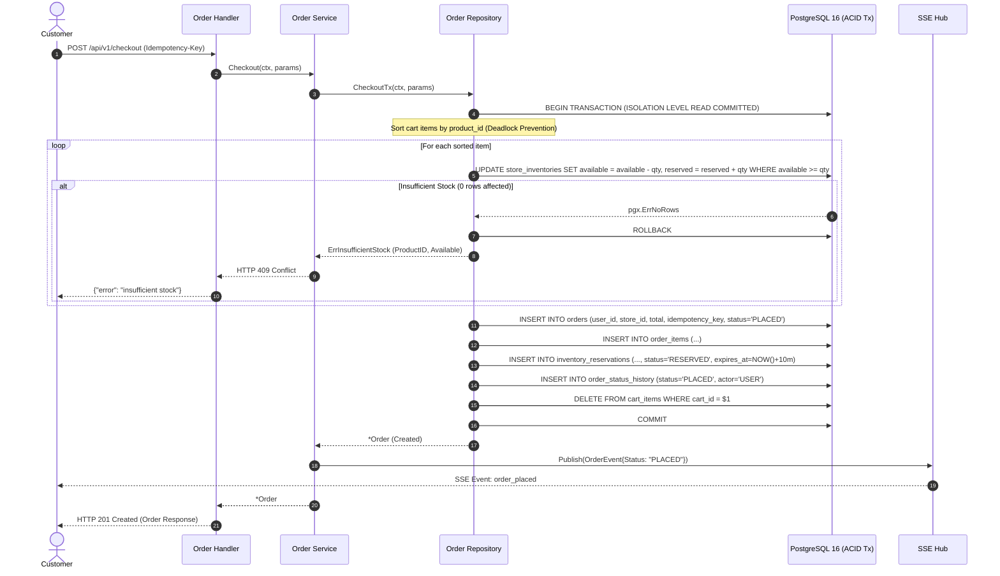
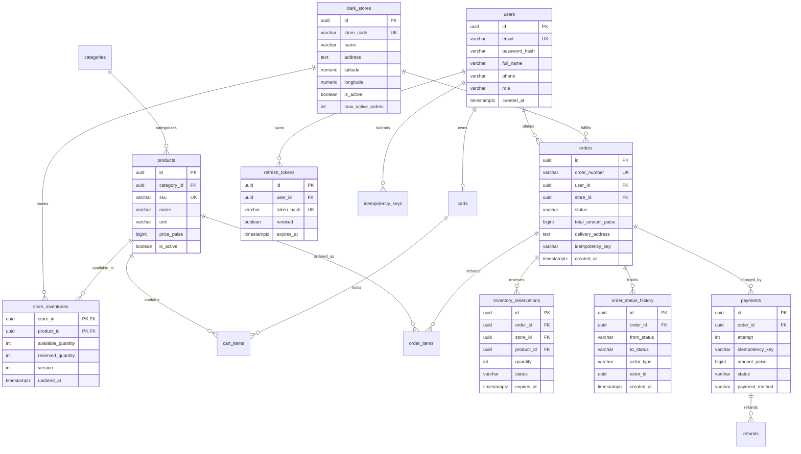

# QuickCart — Concurrent Quick-Commerce Engine

[](https://golang.org)
[](https://github.com/Dhanya562004/quickcart-go/actions/workflows/ci.yml)
[](LICENSE)
[](https://quickcart-go.onrender.com)
[](https://quickcart-go.onrender.com/docs)

QuickCart is a high-throughput, concurrent quick-commerce backend engine built in **Go 1.25**, engineered around the operational constraints of ultra-fast micro-fulfillment platforms (such as Blinkit, Zepto, and Swiggy Instamart). 

Under flash-sale surges, traditional e-commerce backends suffer from inventory overselling, database lock contention, and connection exhaustion. QuickCart solves these challenges at the data and concurrency layer through **deterministic sorted row-level locking**, **atomic conditional PostgreSQL updates**, **deadlock-free ACID transactions**, **asynchronous `SKIP LOCKED` reservation sweeps**, and **Redis/Valkey sliding-window rate limiting**.

The application is deployed live in production as a modular monolith on **Render**, backed by a serverless **Neon PostgreSQL** database and a managed **Aiven Valkey** (Redis-compatible) cache.

---

## Navigation

- [Live Deployment](#live-production-deployment)
- [Engineering Highlights](#engineering-highlights)
- [System Architecture](#system-architecture)
- [Concurrent Checkout Architecture](#concurrent-checkout-architecture)
- [API Overview](#api-overview)
- [Database Schema & ER Design](#database-design)
- [Reliability & Security](#reliability-and-security)
- [Testing & Quality Assurance](#testing--quality-assurance)
- [Local Development Setup](#local-development)
- [Engineering Trade-offs](#engineering-trade-offs)
- [Future Roadmap](#future-roadmap)

---

## Live Production Deployment

QuickCart is deployed in production on managed cloud infrastructure:

| Component | Target Platform | Endpoint / URI | Status |
| :--- | :--- | :--- | :--- |
| **Backend API Service** | Render Free Web Service (Go) | [https://quickcart-go.onrender.com](https://quickcart-go.onrender.com/) | Active (Redirects `GET /` to `/docs`) |
| **Interactive API Docs**| Swagger UI (OpenAPI 3.0) | [https://quickcart-go.onrender.com/docs](https://quickcart-go.onrender.com/docs) | Online |
| **OpenAPI Specification**| Embedded YAML | [https://quickcart-go.onrender.com/api/openapi.yaml](https://quickcart-go.onrender.com/api/openapi.yaml) | Online |
| **Liveness Check** | HTTP Probe | [https://quickcart-go.onrender.com/healthz](https://quickcart-go.onrender.com/healthz) | `200 OK` (`{"status":"alive"}`) |
| **Readiness Check** | Dependency Probe | [https://quickcart-go.onrender.com/readyz](https://quickcart-go.onrender.com/readyz) | `200 OK` (Pings DB & Valkey) |
| **Relational Database** | Neon PostgreSQL 16 Free | AWS us-east-2 (Pooled & Direct via TLS) | Connected (`sslmode=require`) |
| **Cache & Pub/Sub** | Aiven Valkey 7 Free | TLS Protocol (`rediss://`) | Connected |

> [!NOTE]
> **Free-Tier Cold Starts**: QuickCart is hosted on Render's Free tier, which spins down container instances after 15 minutes of inactivity. If the service is cold, the initial HTTP request may experience a ~30–50 second wake-up latency while Render spins up the container. Subsequent requests execute with sub-millisecond Go runtime dispatch.
> 
> **Headless API**: QuickCart is a backend-only REST API. Visiting the root domain [`https://quickcart-go.onrender.com`](https://quickcart-go.onrender.com) automatically issues an HTTP 302 redirect to the interactive Swagger UI at [`/docs`](https://quickcart-go.onrender.com/docs).

---

## Engineering Highlights

### 1. Zero-Overselling Inventory Engine
- **Deterministic Lock Ordering**: When a customer checks out a multi-item cart, the engine sorts all item IDs lexicographically (`sort.Slice` on `product_id`) before touching the database. This guarantees a consistent global lock acquisition order across all concurrent transactions, mathematically eliminating cyclic deadlock conditions.
- **Atomic Tuple-Level Reservation**: Inventory is decremented and reserved inside PostgreSQL via a single conditional atomic statement:
  ```sql
  UPDATE store_inventories
  SET available_quantity = available_quantity - $qty,
      reserved_quantity  = reserved_quantity + $qty,
      version            = version + 1,
      updated_at         = NOW()
  WHERE store_id = $store_id
    AND product_id = $product_id
    AND available_quantity >= $qty
  RETURNING store_id, product_id, available_quantity, reserved_quantity;
  ```
  If available inventory is insufficient, PostgreSQL affects 0 rows, returning `pgx.ErrNoRows`. The entire transaction aborts immediately with an `ErrInsufficientStock` error (HTTP 409 Conflict), guaranteeing stock is never oversold or driven below zero.

### 2. High-Throughput Reservation Expiry with `SKIP LOCKED`
- Reservations are time-bound (10-minute hold window).
- An asynchronous background worker sweeps expired reservations using `SELECT ... FOR UPDATE SKIP LOCKED`:
  ```sql
  SELECT id, order_id, store_id, product_id, quantity
  FROM inventory_reservations
  WHERE status = 'RESERVED' AND expires_at <= NOW()
  ORDER BY expires_at ASC
  LIMIT $1
  FOR UPDATE SKIP LOCKED;
  ```
- Workers skip rows currently locked by in-flight checkout transactions. Expired stock is restored back to `available_quantity` atomically, and the associated order is marked `CANCELLED` with an audit event (`SYSTEM_EXPIRED`).

### 3. Distributed Order Tracking via Server-Sent Events (SSE) & Pub/Sub
- Live delivery transitions (`PLACED` -> `CONFIRMED` -> `PACKED` -> `OUT_FOR_DELIVERY` -> `DELIVERED`) are broadcast to customers in real time.
- Uses an in-memory subscription multiplexer (`tracking.SSEHub`) linked to Redis/Valkey Pub/Sub topic `quickcart:order_events`.
- Events emitted on any cluster node are broadcast to subscribers connected to any other node. Nodes stamp messages with their `InstanceID` to eliminate local duplicate broadcasts.
- Verified leak-free under client disconnection using `go.uber.org/goleak`.

### 4. Sliding-Window Rate Limiting via Atomic Lua Script
- Protects public and authenticated endpoints using Redis/Valkey sorted sets (`ZSET`).
- An atomic Lua script prunes expired request timestamps, counts requests within the active sliding window, and conditionally logs the request with a composite member key (`timestamp:uuid`) to prevent counter collisions during microsecond bursts.
- Excess requests receive HTTP 429 Too Many Requests with calculated `Retry-After` headers.

### 5. Resilient Cache-Aside Pattern with Automatic Fallback
- Dark store product catalogs are cached in Valkey under `quickcart:product:<uuid>` with a 1-hour TTL.
- Catalog writes and inventory adjustments invalidate affected cache keys.
- If Valkey experiences downtime or connectivity lag, `redis.GetOrSet` catches the error, logs a warning, and transparently falls back to PostgreSQL without interrupting customer traffic.

### 6. Atomic Single-Use Refresh Token Rotation
- Authentication issues short-lived JWT access tokens (15-minute TTL) and secure random refresh tokens (7-day TTL).
- Refresh tokens are stored in PostgreSQL solely as SHA-256 hashes (`token_hash`).
- Token rotation executes as an atomic single-row transaction (`UPDATE refresh_tokens SET revoked = true ... WHERE token_hash = $1 AND revoked = false AND expires_at > NOW()`). Replaying an already-revoked refresh token fails immediately, thwarting token theft attempts.

### 7. Idempotent Payment Pipeline
- Generates a deterministic idempotency key (`pay_order_<order_id>`) for each order checkout.
- Simulated payment gateway integration executes with exponential backoff and randomized full jitter across retry attempts.
- In-flight retries log individual attempts to the `payments` table with a compound constraint `(order_id, attempt)`, preventing duplicate charges across network retries.

---

## System Architecture

QuickCart is structured as an idiomatic **Go modular monolith**. Logical domain packages maintain clear boundaries while running within a single binary to minimize operational complexity and latency.

```mermaid
graph TD
    subgraph Clients["Clients & Edge"]
        Browser["Web / Mobile Clients"]
        SwaggerUI["Swagger UI (/docs)"]
    end

    subgraph Hosting["Render Free Web Service (Go Runtime)"]
        Router["Gin HTTP Engine (:PORT)"]
        
        subgraph Middlewares["Middleware Chain"]
            ReqID["Request ID"]
            Logger["Structured slog"]
            Recovery["Panic Recovery"]
            CORS["CORS Policy"]
            Metrics["Prometheus Collector"]
            RateLimit["Lua Rate Limiter"]
            AuthMiddleware["JWT Authentication & RBAC"]
        end

        subgraph CoreDomains["Domain Services"]
            AuthSvc["Auth Service"]
            CatalogSvc["Catalog Service"]
            CartSvc["Cart Service"]
            OrderSvc["Order Service"]
            PaymentSvc["Payment Service"]
        end

        subgraph ConcurrencySubsystem["Background Concurrency Engine"]
            ChannelQueue["Channel Queue (Bounded Buffer: 1000)"]
            WorkerPool["Worker Pool (Supervised Goroutines)"]
            ExpiryWorker["Reservation Expiry Sweeper (SKIP LOCKED)"]
            SSEHub["Distributed SSE Hub (Pub/Sub)"]
        end
    end

    subgraph DataTier["Data & Persistence Tier"]
        subgraph Neon["Neon Serverless PostgreSQL 16"]
            PGPool["pgxpool Connection Pool (Max: 10)"]
            Tables["ACID Relational Tables & Row Locks"]
        end

        subgraph Aiven["Aiven Valkey 7 (Redis-Compatible)"]
            ValkeyCache["Product Catalog Cache (TTL: 1h)"]
            ValkeyRate["Sliding Window ZSETs"]
            ValkeyPubSub["Pub/Sub Topic: quickcart:order_events"]
        end
    end

    Browser -->|HTTP REST / SSE| Router
    SwaggerUI -->|HTTP REST| Router
    Router --> Middlewares
    Middlewares --> CoreDomains

    CoreDomains --> ChannelQueue
    ChannelQueue --> WorkerPool
    WorkerPool --> PGPool

    ExpiryWorker -.->|Polls every 1s (SKIP LOCKED)| PGPool
    OrderSvc -->|ACID CheckoutTx| PGPool
    AuthSvc -->|Token Verification| PGPool
    CatalogSvc -->|Cache-Aside Check| ValkeyCache
    CatalogSvc -.->|Cache Miss Fallback| PGPool

    OrderSvc -->|Publish State Events| SSEHub
    SSEHub <-->|Distributed Bridge| ValkeyPubSub
    SSEHub -->|Text/Event-Stream| Browser
    PGPool --> Tables
```

---

## Concurrent Checkout Architecture

The checkout process coordinates inventory validation, multi-item reservation, order creation, audit logging, and cart clearance in a single ACID transaction.

### Step-by-Step Transaction Flow

1. **Idempotency Verification**: Checks `(user_id, idempotency_key)` against the `orders` table. If the order was already placed, the existing order is returned immediately.
2. **Deterministic Item Sorting**: Items in the cart are sorted ascending by `product_id`. When concurrent checkouts involve overlapping products (e.g., Cart A has products [1, 2] and Cart B has products [2, 1]), sorting ensures both transactions attempt to lock row 1 before row 2, eliminating deadlocks.
3. **Atomic Conditional Reservation**: For each item, `ReserveInventoryAtomic` executes an `UPDATE` requiring `available_quantity >= requested`. If any product has insufficient stock, PostgreSQL affects zero rows, returning `pgx.ErrNoRows`, and the transaction aborts with `ErrInsufficientStock`.
4. **Order Insertion**: The master order record is created with initial state `PLACED`.
5. **Item & Reservation Rows**: Inserts `order_items` records and corresponding `inventory_reservations` records tagged with an expiration timestamp (`NOW() + 10m`).
6. **Status History Audit**: Writes an entry to `order_status_history` recording the transition from `nil` to `PLACED` by `actor_type = 'USER'`.
7. **Cart Clearance**: Deletes all items from the customer's cart and resets store affinity.
8. **Commit**: The transaction commits, releasing row locks. If any step fails, all changes roll back completely.

### Sequence Diagram



---

## API Overview

QuickCart exposes a clean, versioned RESTful API under `/api/v1`. Interactive documentation is accessible via Swagger UI at [`/docs`](https://quickcart-go.onrender.com/docs).

| Category | HTTP Method | Path | Authentication / Role | Description |
| :--- | :---: | :--- | :--- | :--- |
| **System** | `GET` | `/` | Public | Redirects visitors (HTTP 302) to `/docs` |
| **System** | `GET` | `/healthz` | Public | Process liveness probe |
| **System** | `GET` | `/readyz` | Public | Dependency readiness probe (Postgres + Valkey) |
| **System** | `GET` | `/metrics` | Bearer Token / Production | Prometheus scrape endpoint (strictly bounded labels) |
| **Docs** | `GET` | `/docs` | Public | Interactive Swagger UI documentation browser |
| **Docs** | `GET` | `/api/openapi.yaml`| Public | Raw OpenAPI 3.0.3 specification |
| **Auth** | `POST` | `/api/v1/auth/register` | Public | Register customer account (Bcrypt cost 12) |
| **Auth** | `POST` | `/api/v1/auth/login` | Public | Authenticate user credentials & receive token pair |
| **Auth** | `POST` | `/api/v1/auth/refresh` | Public | Rotate refresh token atomically (single-use) |
| **Auth** | `POST` | `/api/v1/auth/logout` | Public | Revoke active refresh token in PostgreSQL |
| **Auth** | `GET` | `/api/v1/auth/me` | Customer / Admin | Retrieve authenticated profile |
| **Catalog** | `GET` | `/api/v1/stores` | Public | List micro-fulfillment dark stores |
| **Catalog** | `GET` | `/api/v1/stores/:id/products` | Public | List inventory products in dark store (Valkey cached) |
| **Admin** | `POST` | `/api/v1/admin/products` | Admin Only | Create catalog product |
| **Admin** | `POST` | `/api/v1/admin/stores/:id/inventory` | Admin Only | Upsert dark store inventory stock |
| **Cart** | `GET` | `/api/v1/cart` | Customer | Retrieve shopping cart and item breakdown |
| **Cart** | `POST` | `/api/v1/cart/items` | Customer | Add product to shopping cart |
| **Cart** | `DELETE`| `/api/v1/cart/items/:product_id` | Customer | Remove specific item from cart |
| **Cart** | `DELETE`| `/api/v1/cart` | Customer | Clear shopping cart |
| **Orders** | `POST` | `/api/v1/checkout` | Customer | Atomic checkout with `Idempotency-Key` |
| **Orders** | `GET` | `/api/v1/orders` | Customer / Admin | List user orders with pagination |
| **Orders** | `GET` | `/api/v1/orders/:id` | Owner / Admin | Retrieve order details and items |
| **Orders** | `POST` | `/api/v1/orders/:id/cancel` | Owner / Admin | Cancel order and restore reserved stock |
| **Payments**| `POST` | `/api/v1/orders/:id/pay` | Owner / Admin | Process payment with jittered backoff |
| **Payments**| `POST` | `/api/v1/orders/:id/refund` | Admin Only | Process idempotent order refund |
| **Payments**| `POST` | `/api/v1/payments/webhook` | HMAC Signature | Verified payment gateway callback (`X-Signature-SHA256`) |
| **Tracking**| `GET` | `/api/v1/orders/:id/track` | Owner / Admin | Real-time SSE order state transitions (`?token=<jwt>`) |

---

## Database Design

The PostgreSQL database is organized to enforce relational integrity, auditability, and deadlock-free concurrent access.



### Key Schema Design Decisions

1. **Composite Primary Key on `store_inventories`**: `(store_id, product_id)` ensures immediate indexed row lookups during checkout lock acquisition, removing the need for a synthetic surrogate key.
2. **Partial Unique Idempotency Index**:
   ```sql
   CREATE UNIQUE INDEX uq_orders_user_idempotency_key 
   ON orders(user_id, idempotency_key) 
   WHERE idempotency_key IS NOT NULL;
   ```
   Allows normal non-idempotent checkouts while enforcing strict deduplication when an idempotency key is supplied.
3. **Optimized Sweep Index**:
   ```sql
   CREATE INDEX idx_reservations_status_expires 
   ON inventory_reservations(status, expires_at);
   ```
   Allows the `SKIP LOCKED` expiry worker to pick candidate expired reservations in `O(log N)` index scan time without sequential table scans.
4. **Immutable Audit History**: `order_status_history` is an append-only ledger tracking every status transition (`from_status`, `to_status`, `actor_type`, `notes`, `created_at`).

---

## Reliability and Security

| Category | Mechanism | Implementation Detail |
| :--- | :--- | :--- |
| **Password Security** | Bcrypt (Cost 12) | Passwords hashed using `golang.org/x/crypto/bcrypt`. Plaintext passwords are never logged or stored. |
| **Authentication** | HMAC-SHA256 JWT | Short-lived access tokens (15m). Production validation enforces a minimum 32-character `JWT_SECRET`. |
| **Token Rotation** | Atomic Single-Use | Stored as SHA-256 hashes. Rotating a token revokes the old record and issues a new pair inside an atomic query. |
| **Authorization** | Strict RBAC | Route groups enforce roles (`admin`, `customer`). Admin endpoints (`/admin/*`) reject non-admin tokens with HTTP 403. |
| **Rate Limiting** | Sliding-Window Lua | Redis Lua script ensures zero race conditions during burst traffic. Returns `429 Too Many Requests`. |
| **Connection Pooling** | `pgxpool` Tuning | Configured with `DB_MAX_CONNS` (10 on Neon Free), idle timeouts, connection lifetimes, and health check delays. |
| **Metrics Protection** | Scrape Token Auth | Production `GET /metrics` requires a `Bearer <token>`. Label dimensions are strictly bounded (`method`, `status`, `route`). |
| **Graceful Shutdown** | POSIX Signal Trap | Catches `SIGTERM` / `SIGINT`. Drains HTTP server (10s), halts expiry worker, drains worker pool, and closes SSE channels. |

---

## Testing & Quality Assurance

QuickCart maintains comprehensive unit, concurrency, and race-detector test suites.

```bash
# Run all unit tests across all packages
go test ./...

# Run complete test suite with the Go Data Race Detector
go test -v -race ./...

# Verify OpenAPI specification validity and server endpoints
go test -v ./api

# Test server routing, health checks, and root redirection
go test -v ./cmd/server
```

### Verified Test Suites

- **Concurrency & Flash-Sale Verification** (`internal/order/headline_race_test.go`):
  Simulates extreme contention where 1,000 distinct customer goroutines submit simultaneous checkouts against an inventory of exactly 10 units. Assertions verify that:
  - Exactly 10 checkouts succeed (`HTTP 201 Created`).
  - Exactly 990 checkouts are rejected (`HTTP 409 Conflict`).
  - Final available inventory is exactly 0 (never negative).
  - Final reserved inventory is exactly 10.
  - Zero deadlocks or orphaned reservations occur.
- **Race Condition Detection** (`internal/order/race_test.go`):
  Validates concurrent basket checkouts, two-user races for single items, and cancellation races under the Go race detector (`-race`).
- **Goroutine Leak Prevention** (`internal/tracking/sse_test.go`):
  Uses `go.uber.org/goleak` to verify that active SSE client channels and background subscription goroutines cleanly terminate upon client disconnect.
- **Integration Suites** (`internal/testutil/testcontainers_test.go`):
  Spins up ephemeral PostgreSQL 16 and Redis 7 containers using Testcontainers to validate end-to-end repository operations against actual database instances.

---

## Local Development

### Prerequisites

- **Go**: Version `1.25+`
- **PostgreSQL**: Version `16+` (or Docker)
- **Redis / Valkey**: Version `7+` (or Docker)

### Option 1: Docker Compose (Full Stack)

Launch the complete multi-instance cluster (PostgreSQL 16, Redis 7, 3 API Replicas, Nginx, Prometheus, Grafana) with a single command:

```bash
docker compose -f deployments/docker-compose.yml up --build -d
```

- **Application Ingress**: `http://localhost:8080`
- **Swagger Documentation**: `http://localhost:8080/docs`
- **Grafana Dashboards**: `http://localhost:3000` (User: `admin`, Pass: `admin`)
- **Prometheus Scraper**: `http://localhost:9090`

### Option 2: Running Directly on Host

1. **Clone the Repository**:
   ```bash
   git clone https://github.com/Dhanya562004/quickcart-go.git
   cd quickcart-go
   ```

2. **Configure Environment Variables**:
   Copy the example environment configuration template:
   ```bash
   cp .env.example .env
   ```
   Ensure `DATABASE_URL` and `REDIS_URL` point to your local database and cache instances.

3. **Execute Database Migrations**:
   Using `golang-migrate`:
   ```bash
   migrate -path migrations/ -database "$DATABASE_URL" up
   ```
   Or apply directly via `psql`:
   ```bash
   psql "$DATABASE_URL" -f migrations/000001_init_schema.up.sql
   psql "$DATABASE_URL" -f migrations/000002_auth_refresh_tokens.up.sql
   ```

4. **Run the Application**:
   ```bash
   go run ./cmd/server
   ```
   The server will start listening on `http://0.0.0.0:8080`.

5. **Access Interactive Documentation**:
   Navigate to [`http://localhost:8080/docs`](http://localhost:8080/docs) in your browser.

---

## Engineering Trade-offs

| Architectural Decision | Chosen Approach | Alternative Considered | Engineering Rationale |
| :--- | :--- | :--- | :--- |
| **System Architecture** | Modular Monolith | Microservices Architecture | In quick-commerce, low latency (< 100ms checkout) is paramount. A modular monolith eliminates network serialization hops and avoids the complexity of distributed transactions (Two-Phase Commit or Sagas), while maintaining clear domain boundaries for future service decoupling. |
| **Inventory State** | PostgreSQL as Source of Truth | Redis as Primary Inventory Store | While Redis offers in-memory write speeds, relational ACID transactions in PostgreSQL provide absolute consistency guarantees, crash durability, and check constraints (`available_quantity >= 0`). |
| **Concurrency Control** | Conditional Atomic `UPDATE`s | Application-Level Mutexes | In-memory mutexes only protect a single process instance. Conditional SQL `UPDATE`s push lock evaluation to PostgreSQL tuple-level locking, functioning safely across horizontally-scaled API replicas. |
| **Deadlock Prevention** | Deterministic Key Sorting | Retry on PostgreSQL Deadlock (40P01) | Retrying on deadlock wastes database CPU and increases tail latency. Lexicographically sorting cart item IDs guarantees a single lock acquisition direction, preventing deadlocks before they can occur. |
| **Background Processing**| Channel-Backed Worker Pool | External Broker (Kafka / RabbitMQ) | For single-binary deployments, bounded Go channels provide sub-microsecond enqueue latency without external broker overhead. Worker pool graceful draining guarantees zero dropped in-flight tasks during deployment rollouts. |
| **Cloud Hosting Tier** | Free-Tier Multi-Cloud (Render + Neon + Aiven) | Paid AWS / GCP Cluster | Enables fully functional public cloud verification with zero operational cost. Sized connection pools (`DB_MAX_CONNS=10`) and TLS configurations (`sslmode=require`, `rediss://`) adapt safely to free-tier constraints. |

---

## Future Roadmap

- [ ] **Distributed Load Benchmarking**: Execute k6 load tests against multi-region cloud deployments to measure WAN latency profiles.
- [ ] **OpenTelemetry Instrumentation**: Distributed trace propagation across HTTP handlers, SQL queries, and Redis operations via OpenTelemetry and Jaeger.
- [ ] **Webhook Dispatcher**: External merchant webhook worker pool with exponential retry queues and dead-letter storage.
- [ ] **Web Shopping Frontend**: Modern customer-facing storefront built in React / Next.js / TypeScript interacting with the live Render API.

---

## License

This project is open-source and licensed under the [MIT License](LICENSE).
