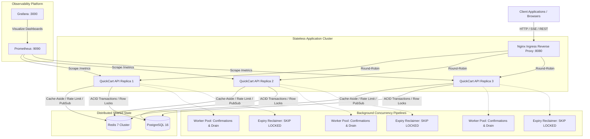
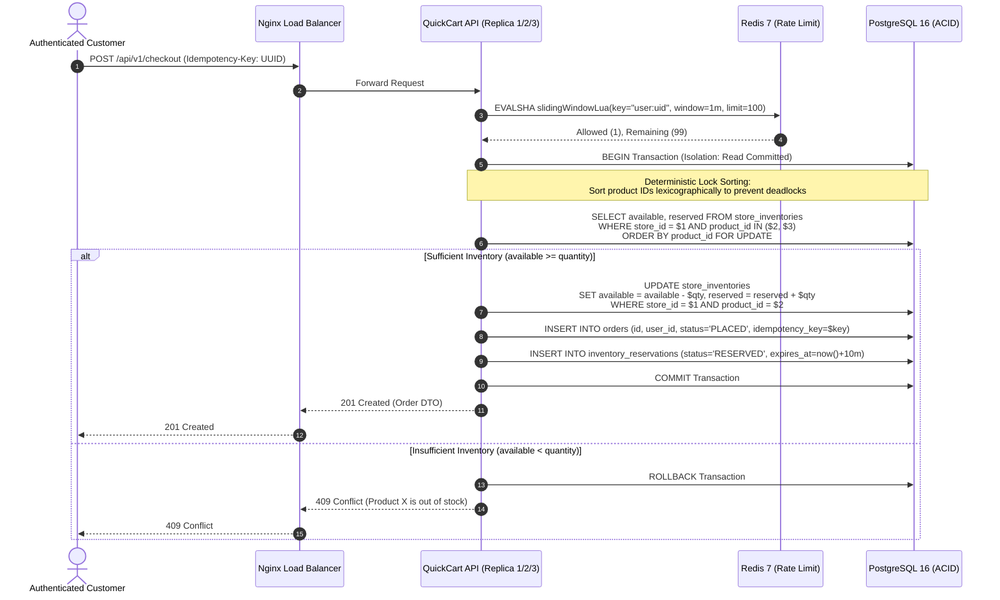
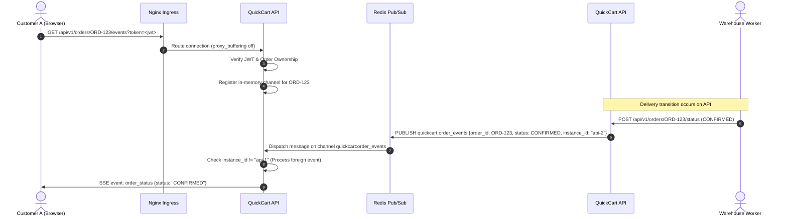
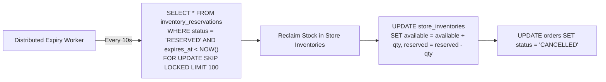

# QuickCart — System Architecture

QuickCart is engineered as a high-concurrency, distributed quick-commerce backend in **Go 1.25**, inspired by the operational architectures of **Swiggy Instamart, Blinkit, and Zepto**. It delivers strict sub-10-minute SLA order fulfillment, atomic inventory reservations with zero overselling, and live delivery tracking.

---

## 1. High-Level Distributed Topology

The production architecture consists of an **Nginx ingress load balancer** distributing client traffic across **three stateless Go API instances**, backed by a shared **PostgreSQL 16 relational database** and **Redis 7 in-memory cache/pub-sub cluster**, with integrated **Prometheus and Grafana observability**.

---

## 2. Distributed Concurrency & Inventory Guarantees

### Zero-Overselling Flash Sale Checkout

Under quick-commerce flash sales, thousands of users compete for limited items simultaneously. QuickCart achieves mathematical zero-overselling through deterministic row-level locking in PostgreSQL:

---

## 3. Distributed Real-Time SSE Architecture

Browser `EventSource` connections stream live order status transitions. Because clients can connect to any of the 3 API instances behind Nginx, QuickCart uses **Redis Pub/Sub** to bridge instances:

---

## 4. Background Expiry Sweeps (`FOR UPDATE SKIP LOCKED`)

Unfulfilled reservations expire after 10 minutes (SLA window). The expiry worker reclaims abandoned stock without blocking concurrent checkout transactions:

---

## 5. Security & Isolation Architecture

1. **Zero-Trust Identity**: Identity is never inferred from unverified client headers (`X-User-ID`, `X-User-Role`) or query parameters. Identity is strictly decoded from cryptographically verified HMAC-SHA256 JWT access tokens.
2. **Atomic Token Rotation**: Refresh tokens are stored as SHA-256 hashes in PostgreSQL. Single-use rotation uses row locks (`SELECT ... FOR UPDATE`) to eliminate race conditions and token replay attacks.
3. **Nginx Query Parameter Sanitization**: Nginx regex maps redact sensitive JWT tokens (`?token=eyJ...`) from HTTP access logs to prevent token leakage in log aggregation systems.
4. **Network Isolation**: PostgreSQL (`quickcart-db`) and Redis (`quickcart-redis`) are strictly isolated on internal Docker bridge networks and are unreachable from public networks.
